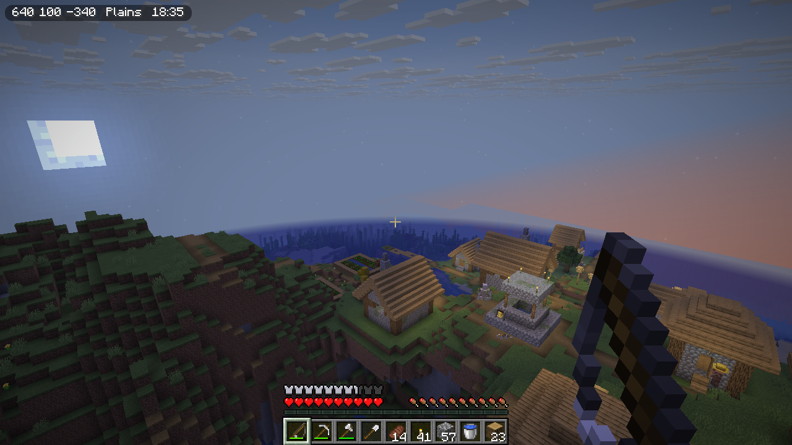
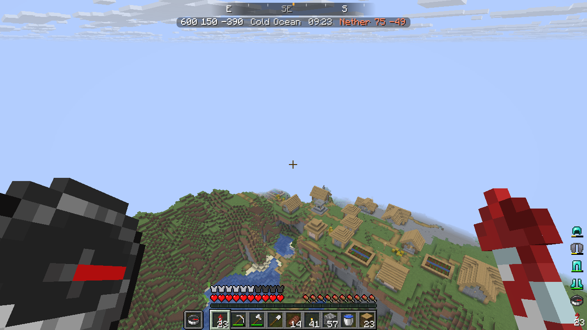
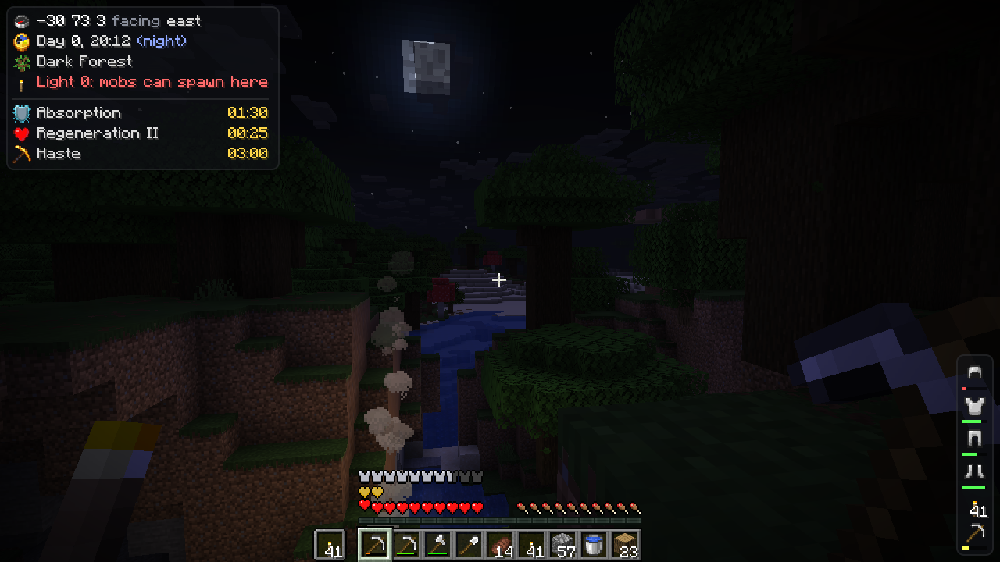
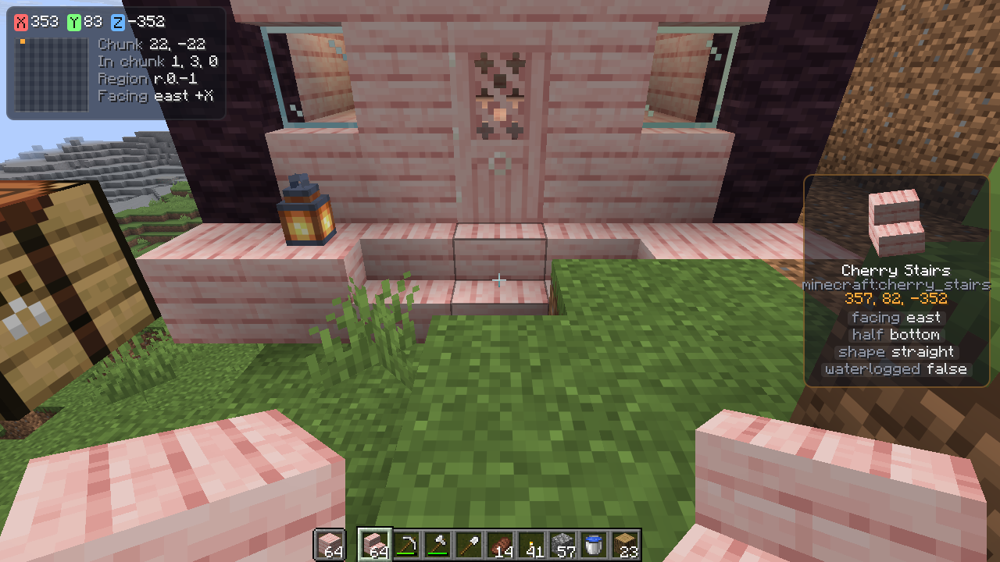
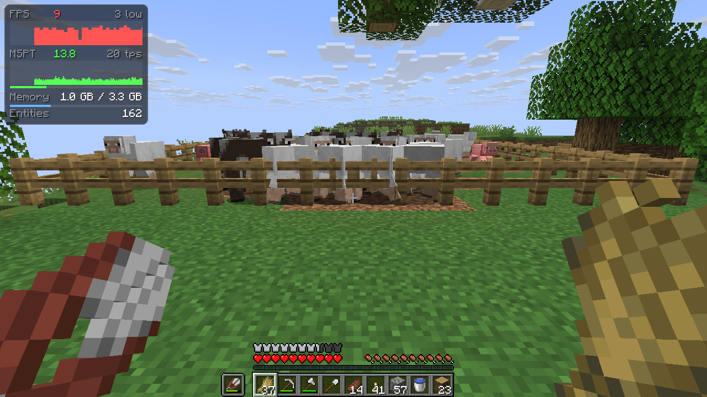

# Hudsmith

Hudsmith draws your HUD from a web page, `hud.html` and `hud.css` in your config folder. You pick which values go on
it and style them with CSS, and the HUD reloads when you save the file.

Hudsmith is powered by the web engine [Vellum](https://github.com/MaxLeiter/vellum), which enables live reloading, Vue-like templating (`v-if`, `v-for`, `@click`, etc), and JavaScript.


## What a HUD looks like

The Minimal template;

<table>
<tr>
<td width="50%">

```html
<link rel="stylesheet" href="hud.css">
<script src="hudsmith:vellum/lib/hud.js"></script>

<div class="pill" v-if="!debug">
  <span>{{ bx }} {{ by }} {{ bz }}</span>
  <span>{{ biome.name }}</span>
  <span>{{ clock(time) }}</span>
</div>
```

```css
.pill {
  position: absolute; top: 4px; left: 4px;
  display: flex; gap: 8px;
  padding: 2px 6px; border-radius: 6px;
  background: rgba(0, 0, 0, 0.45);
  color: #ffffff; text-shadow: minecraft;
}
```

</td>
<td></td>
</tr>
</table>

Vellum's [scripting docs](https://github.com/MaxLeiter/vellum/blob/main/docs/SCRIPTING.md) cover documents what your page may contain.

## Templates

<table>
<tr>
<td width="40%">

**[Minimal](common/src/main/resources/assets/hudsmith/vellum/templates/minimal/hud.html)**

Shows your coordinates, biome and time in the top-left corner. 

</td>
<td></td>
</tr>
<tr>
<td>

**[Compass](common/src/main/resources/assets/hudsmith/vellum/templates/compass/hud.html)**

Puts a compass strip across the top of the screen that slides as you turn. Your armor and tools are in the
bottom-right corner.

</td>
<td></td>
</tr>
<tr>
<td>

**[Survival](common/src/main/resources/assets/hudsmith/vellum/templates/survival/hud.html)**

Each row starts with an item icon. Light turns red where hostile mobs can spawn and effects show their icon and
the time left. 

</td>
<td></td>
</tr>
<tr>
<td>

**[Builder](common/src/main/resources/assets/hudsmith/vellum/templates/builder/hud.html)**

Shows the block/entity you're looking at as a slowly rotating model with some useful metadata with a small map of the chunk.

</td>
<td></td>
</tr>
<tr>
<td>

**[Performance](common/src/main/resources/assets/hudsmith/vellum/templates/performance/hud.html)**

Graphs your frame rate and the server's tick time over the last 30 seconds using `<canvas>`

</td>
<td></td>
</tr>
</table>

## Using it

- `/hudsmith` opens the Hudsmith screen. It lets you choose from a template and has an API reference for variables you can use in your HUD
- HUD files belong in `config/hudsmith/` (also accessible from `/hudsmith`)
- You can bind hiding/showing the UI to keybinds in settings


## Values

Numbers are `Number`s and anything with parts or attributes is an object, such as `biome.name`, `mainhand.durability`,
`target.properties` or `scoreboard.scores`.

`hudsmith:vellum/lib/hud.js` has some helpers for casting values to text, such as `fmt(x)`, `chunk(x)`, `region(x, z)`,
`otherWorld(dimension, x, z)` for Nether coordinates, `clock(time)`, `heading(yaw)`, `wearColor(stack)` and `roman(n)`. Add
`<script src="hudsmith:vellum/lib/hud.js"></script>` to use them.

Every value is listed [here](docs/values.md). 

## Requirements

| Minecraft | NeoForge | Fabric |
|---|---|---|
| 26.3 | 26.3.0.26-beta+ | Loader 0.19.5+, Fabric API |
| 26.2 | 26.2.0.88+ | Loader 0.19.5+, Fabric API |
| 1.21.1 | 21.1.255+ | Loader 0.19.5+, Fabric API |

Hudsmith needs [Vellum](https://github.com/MaxLeiter/vellum) 0.9.0 or newer.

## For mod developers

Your mod can add values that players put on their HUD. Register them on the client during setup:

```java
HudsmithApi.register("mymod_mana", "My Mod", "Your mana, 0 to 100", () -> Mana.of(Minecraft.getInstance().player));
```

A value is read once a tick while a world is loaded, and returns a `String`, `Number`, `Boolean`, Gson `JsonElement`
or `null`. Start the name with your mod id. 

## Building

Gradle needs JDK 25. `./gradlew build` builds every Minecraft version and loader; one target is
`./gradlew :fabric:26.2:build`, and the jars land in `<loader>/versions/<mc>/build/libs/`.
`./gradlew :neoforge:26.3:runClient` starts a dev client.
